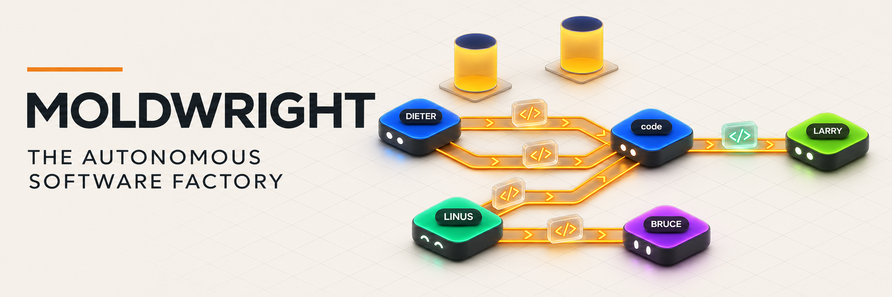
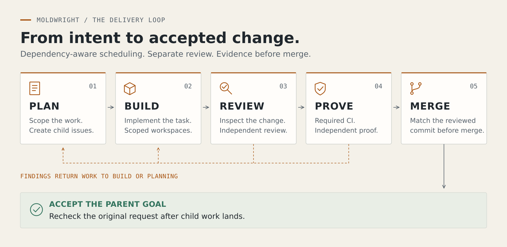
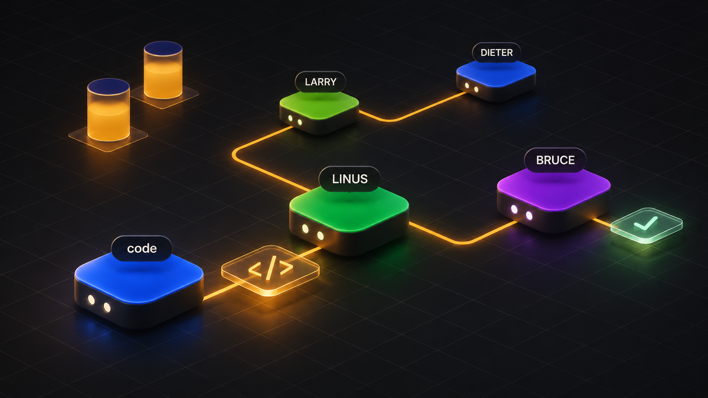

<p align="center">
  <picture>
    <source media="(prefers-color-scheme: dark)" srcset=".github/assets/moldwright/hero-dark.png">
    
  </picture>
</p>

<h1 align="center">MoldWright</h1>

<p align="center">
  <strong>Turn a defined goal into reviewed, tested, merged software.</strong><br>
  An agentic software factory with planning, specialized workers, verification gates, and a visible production floor.
</p>

<p align="center">
  <a href="LICENSE"></a>
  <a href="https://github.com/special-place-ai-heaven/moldwright/actions/workflows/ci.yml"></a>
  <a href="https://github.com/special-place-ai-heaven/moldwright/actions/workflows/factory-tools.yml"></a>
</p>

<p align="center">
  <a href="#how-work-moves">Workflow</a> ·
  <a href="#inside-the-factory">Capabilities</a> ·
  <a href="#run-moldwright">Deployment</a> ·
  <a href="#explore-the-code">Code</a> ·
  <a href="https://github.com/special-place-ai-heaven/moldwright/issues">Issues</a>
</p>

## A production process for software

You define the outcome and constraints. MoldWright turns that work into scoped issues, assigns workers, follows dependencies, coordinates reviews, checks evidence, and advances changes through the delivery process.

The factory keeps the work visible: what is running, what is waiting, which job has a problem, and what has completed. Its dispatcher carries the workflow between stages, with persistent state and explicit conditions for moving forward.

**The unit of progress is a change that satisfies its requirements.** A pull request passes through review and configured checks; an independent proof stage checks its individual requirements. Parent acceptance then checks whether the completed pieces satisfy the original goal.

## How work moves

<p align="center">
  <picture>
    <source media="(prefers-color-scheme: dark)" srcset=".github/assets/moldwright/factory-flow-dark.svg">
    
  </picture>
</p>

1. **Define and plan.** Establish the goal, inspect the repository, and divide the work into child issues with file scope, dependencies, and done criteria.
2. **Queue and build.** Eligible work receives available workers. Capacity limits and file ownership keep concurrent work within its assigned boundaries.
3. **Review and check.** Reviewers inspect the change. Required CI workflows must pass on the commit being considered for merge.
4. **Prove and merge.** A separate worker checks the requirements against evidence. The dispatcher verifies the current commit and merges when its gates pass.
5. **Accept the whole.** After the children finish, acceptance checks the parent goal against the assembled result and records any remaining gaps.

Rejected work can return for a fix or a revised plan. Limits, holds, and explicit blocked states bound the process when it cannot continue.

## Inside the factory

| Capability | What it does |
| --- | --- |
| **Scoped work orders** | Carries the change, allowed files, dependencies, and verification commands into each job. |
| **Specialized worker pools** | Assigns planning, coding, reviewing, proof, and acceptance work to the relevant roles. |
| **Dependency and capacity control** | Waits for prerequisites and available capacity; coordinates file ownership to reduce collisions. |
| **Evidence before merge** | Combines review, required CI, and requirement-level proof; a changed commit returns for fresh review. |
| **Recovery and escalation** | Tracks retries, stalled work, failures, holds, and replanning instead of losing the job between runs. |
| **Model selection by task** | Configures model and reasoning effort by station and task size. |
| **Usage visibility** | Records token usage, cache reads and writes, and configured cost estimates across work. Estimates are separate from provider billing. |
| **A visible production floor** | Presents jobs, departments, worker pools, activity, problems, and work orders in the factory interface. |

<p align="center">
  
  <br><sub>Brand illustration. The application has its own interactive factory view.</sub>
</p>

## Run MoldWright

MoldWright is self-hosted. The application and agent engine use a Supabase-backed stack, with the factory dispatcher coordinating repository work.

Start with this fork and its active development branch:

```bash
git clone --branch dev https://github.com/special-place-ai-heaven/moldwright.git
cd moldwright
```

Deployment is currently operator-oriented. A working factory also needs the engine, repository access, configured workers and model connections, and the dispatcher configuration for that environment.

- **Existing VPS deployment:** use the [deployment runbook](docs/deploy.md), including image selection, migrations, and post-deploy checks.
- **Service configuration:** inspect the [VPS Compose overlay](deploy/vps/docker-compose.vps.yml), [factory dispatcher service](deploy/vps/factory-dispatcher.yml), and [dispatcher configuration](tools/factory/dispatch.json).
- **Application and engine:** see [application documentation](apps/ui/README.md), [engine documentation](apps/engine/README.md), and the [environment example](.env.example).

The inherited [installation guide](INSTALL.md) still contains Rerun-specific setup instructions and upstream repository references. It is background for the base platform, not a complete fresh-install guide for MoldWright's factory. For source development, use the Node.js and pnpm versions declared in [package.json](package.json).

## Explore the code

| Area | Entry point |
| --- | --- |
| Factory dispatcher and lifecycle | [`tools/factory/dispatch.py`](tools/factory/dispatch.py) |
| Planning and task decomposition | [`tools/factory/planning.py`](tools/factory/planning.py) |
| Ready-work eligibility and runner | [`tools/factory/readyq.py`](tools/factory/readyq.py), [`runner_loop.py`](tools/factory/runner_loop.py) |
| Requirement proof and parent acceptance | [`tools/factory/proof.py`](tools/factory/proof.py), [`acceptance.py`](tools/factory/acceptance.py) |
| Factory interface | [`apps/ui/components/factory`](apps/ui/components/factory) |
| Agent runtime | [`apps/engine`](apps/engine) |
| Shared contracts | [`packages/contracts`](packages/contracts) |

The application uses TypeScript and React; the factory coordination tools are Python. Runtime behavior depends on the configured workers, providers, gates, and deployment.

## Contributing

Report bugs with reproduction steps and relevant logs through [GitHub Issues](https://github.com/special-place-ai-heaven/moldwright/issues). Include the affected commit and factory stage when applicable. Keep secrets out of reports.

Read [CONTRIBUTING.md](CONTRIBUTING.md) and the repository instructions before submitting changes. Some inherited documentation still uses the original project name.

## Origins and license

MoldWright is an independent project derived from [Rerun](https://github.com/rerun-build/rerun), expanded into a software factory with its own orchestration, verification, and operations workflow.

Licensed under [AGPL-3.0](LICENSE). Original attribution and notices remain in the repository. See [TRADEMARK.md](TRADEMARK.md) for the upstream name and logo policy.
